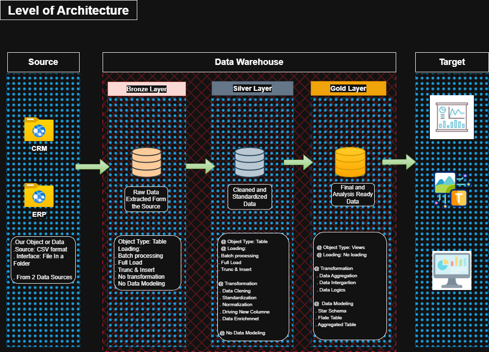

# 🏗️ SQL-Data-Warehouse-Project
Building a fully functional data warehouse project demonstrates a data warehouse project for actionable insight and analytical solutions, using SQL from building a data warehouse to generating actionable insights that include ETL Processing, Data Modeling, and Analytic Metrics.

<details>
<summary><b>📖 Click to expand Overview</b></summary>

 Overview

This project involves:

Data Architecture: Designing a modern data warehouse using a modeling architecture, Bronze, Silver, and Gold Layers.
ETL Processing: Extracting, Transforming, and Loading data from source to warehouse.
Data Modeling: Developing Dimension and Fact Tables that are optimized for analytics and other queries.
Analytics and Reporting: Creating SQL-based reports and dashboards for actionable insights.

</details>


  # 🌟 This Repository is an excellent resource for anyone who wants to showcase expertise in:

[x] SQL Development
[x] Data Architecture
[x] Data Engineering
[x] ETL Pipeline Development
[x] Data Modeling
[x] Data Analytics

  # 🛠️ Important Tools

 Tool 	 Purpose 
 SQL Server 	 Database Engine 
 SQL Server Management Studio 	 Database Management 
 DrawIO 	 Diagramming 
 Notion 	 Documentation 

  🎯 Project Requirements
Building a Data Warehouse (Data Engineering)

# Objectives
> Develop a Modern Data Warehouse Using SQL to consolidate sales data, enabling analytical reporting and informed decision-making.

   # 📋 Specification

   Data Source: Import data from two different sources (CRM and ERP) provided as CSV files.
   Data Quality: Clean, resolve, and transform data quality issues before analytics.
   Integration: Combine both sources into a single user-friendly data model designed for analytics.
   Scope: Focus on the latest dataset only; historization of data is not required.
   Documentation: Provide clear documentation of the data model to support both stakeholders and the analytics team.


 🏛️ Data Architecture

 


🥉 Bronze Layer: Extract data from the source in row form. Data is ingested in CSV format into the SQL Database.
🥈 Silver Layer: This layer includes data cleaning, transformation, standardization, and normalization to prepare data for analytics.
🥇 Gold Layer: It contains a business-ready data model in a star schema required for analytics and reporting.


 
 📂 Repository Structure
 
```text
   SQL-DatawarehuseProject
   │
   ├── 📁 datasets/                  # Raw Dataset
   │
   ├── 📁 docs/                      # All the documents involving this project
   │   ├── 🖼️ Data Flow Diagram.jpeg
   │   ├── 🖼️ Data Mart (Star Schema).jpeg
   │   ├── 🖼️ DWH Architecture Diagram.jpeg
   │   ├── 🖼️ Relationship Schema.jpeg
   │   └── 📄 Data Catalog. md       # Description of the columns in the dimension and fact tables of the gold layers
   │
   ├── 📁 scripts/                   # All SQL scripts used to extract, transform, and load data
   │   ├── 📁 Bronze/                # SQL queries to extract and load data to the Bronze layer
   │   ├── 📁 Silver/                # SQL scripts used to clean and transform, and load data to the Silver layer
   │   └── 📁 Gold/                  # SQL scripts used for analytical modeling
   │
   ├── 📁 tests/                     # Test scripts used to check the quality of the data
   │
   ├── 📄 Readme.md                  # Project Overview and instruction
   └── 📄 .gitignore                 # Files and directories to be ignored by Git
```


 📜 Licensing
This Project is licensed under the MIT license. You are free to use, modify, and share it with people.


 👨💻 About Me
> Hey, I'm Deneke Zewdu, A Data Manager/Analyst/Web Developer, generally a passionate IT professional on a mission to make a difference using data and all the attributes it brings. I enjoy uncovering patterns and insights using data, and I'm enthusiastic about sharing my knowledge about the potential of technology.


 🤝 Let's get in touch
[](https://github.com/danblacknote/SQL-Data-Warehouse-Project/edit/main/README.md)
[](linkedin.com/in/deneke-zewdenhe-06a208208)
[](mailto:danblacknote111@gmail.com)


